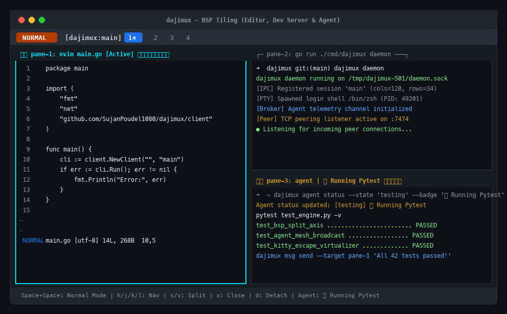
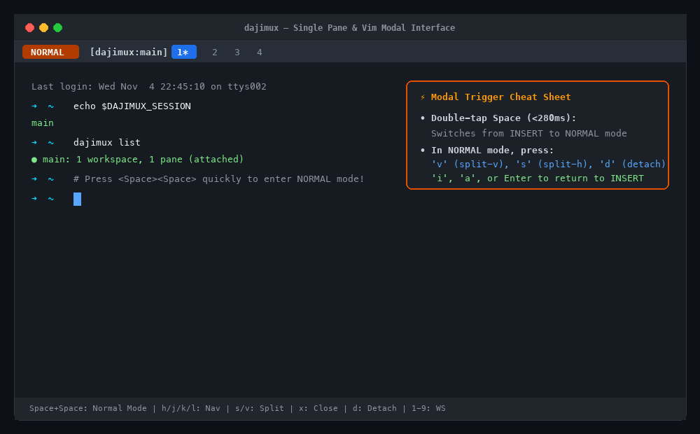

# dajimux

> Modern terminal multiplexer & window manager with vim-like modal interface, BSP tiling, Kitty graphics support, and an agent mesh protocol.



## Features

- **Daemon-Client Architecture**: Sessions stay alive across disconnects and terminal restarts.
- **BSP Tiling Engine**: Binary space partitioning layouts with automated split detection, ratio adjustment, and monocle zoom.
- **Vim-like Modal Ergonomics**:
  - `INSERT`: Seamless, zero-latency passthrough to your shell/process.
  - Double-tap `Space` in insert mode to instantly enter `NORMAL` mode.
  - `NORMAL`: Vim navigation (`h`, `j`, `k`, `l`), splits (`s`, `v`), monocle zoom (`z`), and workspace jumps (`1`-`9`).
  - `RESIZE`: Fine-grained border resizing.
  - `COMMAND PALETTE`: Floating fuzzy finder for instant action dispatch.
- **Agent Mesh Protocol**:
  - Live agent status badges (e.g. Claude Code, Gemini CLI, Aider) rendered in pane headers.
  - Inter-pane message bus (publish/subscribe and point-to-point communication between agents).
  - Safe pane capture and automation hooks.
- **Kitty Graphics Protocol**:
  - Intercepts and translates `\x1b_G` graphic sequences so inline images render correctly within split panes.
- **Cross-Machine Peering**:
  - Authenticated TCP peer listener and client to bridge remote devboxes and sessions seamlessly.
- **Scrollback Vi-Mode & Clipboard**:
  - Per-pane history review with `k`/`j` line scrolling, `g`/`G` top/bottom jumps, and `y` OSC 52 clipboard copying.

## Installation

### macOS & Linux (One-Line Installer)

Install the latest precompiled static binary directly:

```bash
curl -fsSL https://raw.githubusercontent.com/SujanPoudel1080/dajimux/main/install.sh | bash
```

### Homebrew (macOS & Linuxbrew)

```bash
brew tap SujanPoudel1080/tap
brew install dajimux
```

### Linux Packages (.deb / .rpm)

Download prebuilt `.deb` or `.rpm` packages from the [GitHub Releases](https://github.com/SujanPoudel1080/dajimux/releases):

```bash
# Ubuntu / Debian
sudo dpkg -i dajimux_*_linux_amd64.deb

# Fedora / RHEL
sudo rpm -i dajimux_*_linux_amd64.rpm
```

### Go Install

```bash
go install github.com/SujanPoudel1080/dajimux/cmd/dajimux@latest
```

## Quickstart

```bash
# Launch dajimux (spawns daemon in background if not running)
dajimux

# List active sessions and connected clients
dajimux list

# Launch or attach to a named session
dajimux attach my-project

# Initialize or view configuration
dajimux config init          # Generates ~/.config/dajimux/config.yaml
dajimux config path          # Prints path to config file
dajimux config show          # Shows active configuration

# Stop the background daemon and all running sessions
dajimux stop

# Send status update from inside an agent pane
dajimux agent status --state "testing" --badge "🟡 Running Pytest"

# Send a message to an agent in another pane
dajimux msg send --target pane-2 "Schema migration completed"

# Capture the last 50 lines of another pane
dajimux pane capture --pane pane-1 --lines 50

# Peering: Listen on a remote server
dajimux peer listen --addr :7474 --token "my-secret-key"

# Peering: Connect from your laptop to the remote server session
dajimux peer connect remote.devbox.internal:7474 --token "my-secret-key" main
```

## Modal Navigation



- **Double-Tap `Space`**: Switch from `INSERT` mode to `NORMAL` mode.
- In `NORMAL` mode:
  - `h` / `j` / `k` / `l` : Focus left / down / up / right pane
  - `w` : Swap active pane with next pane in tree order
  - `H` / `J` / `K` / `L` : Swap active pane with spatial neighbor (left / down / up / right)
  - `s` : Split pane horizontally
  - `v` : Split pane vertically
  - `m <1-9>` : Move active pane to workspace 1..9
  - `x` : Close active pane
  - `z` : Zoom / toggle monocle (maximize pane)
  - `d` : Detach from session (leaves daemon running in background)
  - `[` or `Ctrl-u` : Enter Vi Scrollback mode
  - `1` - `9` : Switch workspace
  - `r` : Enter resize mode (`h`/`j`/`k`/`l` to adjust splits, `Esc`/`Enter` to finish)
  - `i` / `a` / `Enter` : Return to `INSERT` mode
  - `:` or `Space` : Open Command Palette

- In `COMMAND PALETTE` mode:
  - `↑` / `↓` (or `Ctrl-p` / `Ctrl-n`) : Navigate commands
  - `Enter` : Execute selected command and return to `NORMAL` mode
  - `Esc` or `Ctrl-c` : Dismiss command palette and return to `NORMAL` mode

- In `SCROLLBACK` mode:
  - `k` / `j` : Scroll up / down 1 line (also Up/Down arrows)
  - `Ctrl-u` / `Ctrl-d` : Page up / Page down
  - `g` / `G` : Jump to top / bottom
  - `y` : Yank visible text to system clipboard via OSC 52
  - `q` / `Esc` / `Enter` : Exit scrollback mode

## Mouse Support & Gestures

dajimux supports native SGR 1006 extended mouse reporting out of the box:
- **Click Pane**: Focuses that pane immediately.
- **Click Workspace Tab**: Click any workspace tab (`1`..`9`) in the header to switch to it.
- **Mouse Wheel**:
  - Scroll Up inside any pane to automatically enter Scrollback Vi-mode.
  - Scroll Down to browse back down to real-time shell output.
- **Drag Split Borders**: Click and drag along split borders to resize adjacent panes in real time.

## Configuration

Customize keybindings, modal switching, and colors via `~/.config/dajimux/config.yaml`:

```bash
# Generate starter configuration
dajimux config init
```

```yaml
general:
  default_shell: "$SHELL"
  scrollback_lines: 5000

input:
  prefix_mode: "modal"         # "modal" (Space+Space)
  modal_double_tap_ms: 280     # Double-tap threshold in ms
  custom_leader: " "

theme:
  border_active: "cyan"        # cyan, blue, green, yellow, red, magenta, white
  border_inactive: "gray"      # gray, darkgray, white
  status_bar_bg: "darkgray"    # darkgray, black, gray, navy, blue
  status_bar_fg: "white"
  palette_bg: "darkgray"
  palette_selected_bg: "gray"
```

## Architecture

```
dajimux/
├── cmd/dajimux/          # CLI entry point (Cobra)
├── internal/
│   ├── bsp/              # Binary Space Partitioning window tree
│   ├── client/           # Terminal client, raw mode, modal input handler
│   ├── daemon/           # Daemon server, session & workspace manager
│   ├── pty/              # POSIX pseudoterminal allocation & signals
│   ├── protocol/         # IPC message framing & types
│   ├── agent/            # Agent Mesh broker & client hooks
│   └── kitty/            # Kitty graphics protocol translation & clipping
```

## License

MIT License. See [LICENSE](LICENSE) for details.
